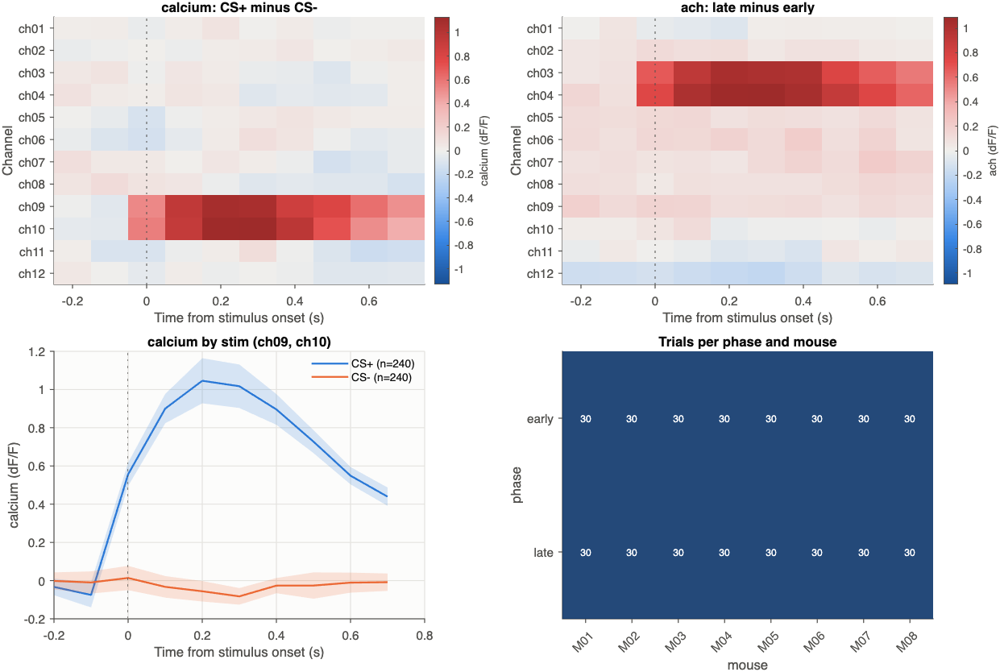
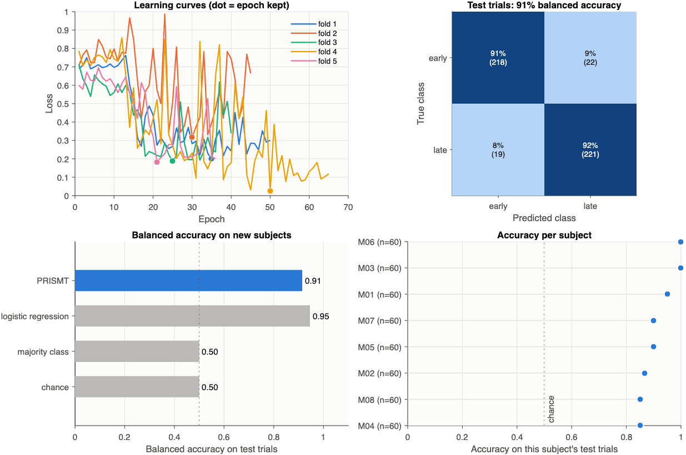

# PRISMT

[](LICENSE)
[](https://doi.org/10.5281/zenodo.24477929)

PRISMT lets you train a modern AI model (a *transformer*, the model of the PRISMt paper) on
your experiment's recordings and ask it two kinds of questions, **without writing code**
and without knowing anything about AI, GPUs or computing clusters. Everything happens in a
MATLAB window with six tabs, in order: **Setup → Data → Task → Model & training → Run →
Results**.

It works with **brain activity, behavior, or both together**, and with any other signal
recorded over time (physiology, stimulus traces...).

## What can I learn with it?

| Question | What PRISMT does | Example |
| --- | --- | --- |
| **Can the recordings tell conditions apart?** | Learns to recognize a trial condition from the signals, then tests itself on animals (or participants) it never saw. | Is early vs late learning visible in cortical activity? Can whisking and pupil predict hit vs miss? |
| **What in the recordings is predictable, and from what?** | Hides part of each trial and learns to fill it in. Shows which channels, which moments and which signals can be predicted from the rest. | Which brain areas are predictable from the others? Can neural activity predict running speed, or the reverse? |
| **Both, when labelled trials are few** | Learns the structure first from all trials, then learns the conditions. | Few sessions with labels, many without. |
| **Which channels, moments and signals drive a classification?** | Explains the trained classifier with the PRISMt method: attribution of each held-out prediction to channel × time × signal, summarized as a few motifs, with the channels that are significant. | Is the learning effect carried by ACh in frontal cortex or by calcium in visual cortex? |

Every result is shown next to **simple reference methods** (guessing, the most common
answer, a straightforward linear model, the trial average). A result is only interesting
when PRISMT does better than these, and the app always shows the comparison.

## What kind of data does it take?

Data recorded in **trials**: repeated, time-aligned windows (for example 1 s before to 3 s
after a stimulus), with information about each trial (which animal, which session, which
condition, the response...).

PRISMT is flexible about what was recorded:

| Your data | Works? | Notes |
| --- | --- | --- |
| Brain activity only (imaging regions, electrodes, neurons, a grid of pixels) | Yes | Any number of channels. |
| Behavior only (running speed, licking, pupil, face motion, body-part positions) | Yes | Each behavior variable is a channel. |
| **Activity and behavior together** | Yes | Each is a separate *signal* with its own channels (e.g. 82 brain regions + 3 behavior variables). You can then ask whether the result needs the brain signal, the behavior, or both. |
| Two or more brain signals (e.g. calcium and acetylcholine) | Yes | Each is a separate signal. |
| Sessions or animals with **different numbers of channels** (different electrodes, regions out of the field of view) | Yes | Channels are matched by name; missing ones are skipped. |
| Some missing values (bad frames, lost tracking) | Yes | Leave them as `NaN`; they are never used or scored. |
| Signals recorded at different sampling rates | After a step | They must share the same time points: resample them first (see [Questions](#common-questions)). |
| Continuous recordings without trials | After a step | Cut them into windows first (*Import file...* does this for continuous recordings). |

In this README, a **channel** is one thing recorded over time (a region, an electrode, a
behavior variable) and a **signal** is a kind of recording made of one or more channels
(e.g. "calcium" with 82 channels, "behavior" with 3).

## Before you start (once per computer)

You need MATLAB R2021a or newer (no toolboxes) and about 3 GB of free disk space.

1. **Get PRISMT.** On [github.com/josueortc/PRISMTransformer](https://github.com/josueortc/PRISMTransformer),
   press *Code → Download ZIP* and unzip it (or `git clone` it if you use git).
2. **Open it.** In MATLAB, go to the unzipped folder and double-click
   **`run_prismt_gui.m`**. The PRISMT window opens.
3. **Set it up.** On the **Setup** tab, press **Create environment**. PRISMT installs the
   software it needs in its own folder (5–15 minutes, no administrator rights needed). When
   the lamp turns green, it says whether training will use a GPU or the CPU. If someone
   already installed it on this computer, press **Find automatically** instead.

## Try it first on demo data (10 minutes)

The demo data imitate an experiment with two brain signals, eight mice and a stimulus, with
effects planted on purpose, so you can see what a real finding looks like.

1. **Data** tab → **Create demo data**.
2. **Task** tab → **Classify trial conditions** → *Predict*: `phase` (early vs late
   learning) → **Check settings**. The *Checks* list says how the trials will be split.
3. **Run** tab → **Start training**. MATLAB stays usable while it trains.
4. **Results** tab → choose the run. *Score vs reference models* should show PRISMT well
   above chance.

Then go back to the **Task** tab, choose **Learn structure (masked autoencoder)**, run it,
and open *Predictability per channel* in the Results tab.

This is what the demo gives with the standard settings: the two planted effects in the data
(top), and a classifier of early vs late learning that is right on 91% of the trials of mice
it never saw, with every mouse well above chance (bottom).





More example figures, for every task, are in the [tutorial](docs/tutorial.md#example-results-on-the-demo-data).

## Using your own data, step by step

### Step 1. Bring your data in (Data tab)

There are three ways, depending on how your data are stored.

**A. Your sessions are saved in a `.mat` file** in one of these common layouts: a table with
one row per session, one struct per session, numbered variables (`dff_001`, `dff_002`, ...),
or continuous recordings per animal. Press **Import file...** and pick the file. PRISMT
shows what it contains and lets you choose, without code:

- **Signal**: which recording to use (choose several to use them all);
- **Channels**: whether the channels are all one signal, or should be split into several
  signals (for example the first half is calcium and the second half acetylcholine);
- **Behavior**: behavior traces stored in the file (running speed, licking, pupil...) to add
  as a separate signal — this is how you get **activity + behavior**;
- **Kind of signal**, names and units, which column identifies the **subject** (animal), and
  the timing if the file does not say it.

Press **Preview** to see how the file will be read, then **Save and use**.

**B. Your data are arrays in MATLAB.** Arrange each recording as **trials × channels ×
time** (one row per trial), and put the trial information in a table with **one row per
trial**. With the PRISMT window open, paste the matching lines below into MATLAB's Command
Window, replacing `dff`, `speed`, `pupil`, `licks` (your recordings) and `info` (your trial
table) with the names of your own variables. Then press **From workspace...** in the Data tab.

*Activity only* (e.g. `dff` is trials × regions × time):

```matlab
ds = prismt.makeDataset(dff, info, SamplingRate=10, TimeZero=-1, Event="stimulus onset", ...
                        Subject="mouse", Session="session", ModalityNames="calcium", ModalityKinds="neural");
```

*Behavior only* (each behavior variable is trials × time):

```matlab
ds = prismt.makeDataset(struct('speed', speed, 'pupil', pupil, 'licks', licks), info, ...
                        SamplingRate=10, TimeZero=-1, Subject="mouse", ModalityKinds="behavior");
```

*Activity and behavior together* (same trials and time points; any number of channels each):

```matlab
ds = prismt.makeDataset(struct('neural', dff, 'speed', speed, 'pupil', pupil), info, ...
                        SamplingRate=10, TimeZero=-1, Subject="mouse", Session="session", ...
                        ModalityKinds=["neural", "behavior", "behavior"]);
```

What the options mean: `SamplingRate` is samples per second; `TimeZero` is the time of the
first sample in seconds (−1 means the window starts 1 s before the event); `Subject` and
`Session` are the names of the columns of `info` that say which animal and which session
each trial comes from. Type `help prismt.makeDataset` for every option.

**C. Recordings that do not share the same channels or signals** (different electrodes per
animal, a signal recorded only in some sessions). Bring each recording in with A or B, then
open one and press **Add dataset...** for the others. Channels and signals with the same
name are matched; the ones a recording lacks are marked missing and skipped by the model.
Name channels consistently: the same electrode must have the same name in every recording.

PRISMT saves your data as a *PRISMT dataset* file in `Documents/PRISMT/datasets`. Next time,
use **Open PRISMT dataset...**.

### Step 2. Look at your data before training (Data tab)

The **Problems found** box lists anything wrong with the file, with what to do. The previews
show your data the way the model will see it:

- **Average** and **Conditions**: the average signal, and the difference between conditions;
- **Single trial**: one trial at a time;
- **Channel map**: one value per channel, and how much data is missing;
- **Trial info**: how many trials each animal contributes to each condition. Empty cells
  matter: if a condition comes from only some animals, the model may learn the animal
  instead of the condition;
- **Channels**: every channel and its signal. Here you can give channels **groups** (brain
  area, left/right, sensor, body part) to later use only some of them.

### Step 3. Choose your question (Task tab)

1. Choose **Classify trial conditions**, **Learn structure (masked autoencoder)**, or
   **Classify, starting from an autoencoder**.
2. *For classification*: choose what to **Predict** (any trial column: condition, phase,
   response, genotype...). In the table, untick values to leave out, or give two values the
   same name to merge them (e.g. hit and correct rejection as "correct").
   *For structure*: choose what to **Hide** while it learns: random values, whole channels,
   the end of each trial (forecasting), or a whole signal (e.g. predict behavior from brain
   activity).
3. **Which trials**: keep only some trials if needed (e.g. only CS+ trials, or only some
   animals).
4. **Which channels and signals**: by default the model uses everything. Untick a signal to
   ask what the others alone can do. For example, train once with brain activity and
   behavior, then once with brain activity only.
5. **How the result is tested**: leave it on *Automatic*. PRISMT then always tests on animals
   the model never saw, and repeats the training so that every animal is tested once
   (cross-validation).
6. Press **Check settings**. The *Checks* list on the right must have no red ✖ before you can
   start. Each item says what to do, and *Go to setting* takes you there.

### Step 4. Choose the model size (Model & training tab)

| Preset | Use it for | Typical time |
| --- | --- | --- |
| **Quick test** | Making sure everything works | Minutes on a laptop |
| **Standard** | Real analyses | Tens of minutes to hours, depending on data size |
| **Paper** | The configuration of the PRISMt paper | Needs a GPU or a cluster |

**Estimate time** tells you how long the run will take on this computer. You do not need to
change anything else. *Show all settings* lists every option with a plain explanation, and
*Find the best model* lets PRISMT try many settings within each cross-validation fold and
keep each fold's best, so the score stays honest (best done on a GPU or a cluster).

### Step 5. Train (Run tab)

- **On this computer**: press **Start training**. You can keep using MATLAB, or even close
  the app: the training continues, and you can find it again in the Results tab. **Stop**
  ends training early and still gives you results from the best model so far.
- **On a cluster** (for large datasets or the Paper preset): choose *On a cluster (SLURM)*
  and press **Create job folder**. PRISMT writes a folder and the exact commands to copy
  and paste to send it to the cluster, start it, and bring the results back. See
  [docs/cluster.md](docs/cluster.md). Your cluster details go once in the Setup tab.

When training ends, a message says how it went: the score, or what went wrong and what to do.

### Step 6. Read the results (Results tab)

Choose a run in the list. The first thing shown is the **Verdict**: plain answers, each with
a green, amber or red mark and the numbers behind it. Is the result above chance? Does the
transformer read more than a simple linear model? Does it hold in most animals? Could a
difference between recording days explain it? Was the model trained enough? If "trained
enough" is not green, fix that first (more epochs, the Standard preset, or *Find the best
model*): an under-trained model's low score says nothing about your recordings.

Then look at:

- **Score vs reference models**: is PRISMT better than the simple methods? If a simple linear
  model does as well, the information is there, but a complex model is not needed to see
  it. That is also a finding.
- **Accuracy per subject**: does the result hold in most animals, or come from one or two?
- **Confusion matrix** and **Confidence**: which conditions are confused with which.
- *For structure*: **Predictability per channel** (which channels the others predict),
  **Gain over baseline per channel** (where the model beats the trial average),
  **Reconstruction example** (one trial, what was hidden, and the model's prediction), and
  **Predictability by condition** (e.g. is behavior more predictable late in learning?).

**Interpret (PRISMt)** explains a classification: which channels, moments and signals the
model uses, as a few motifs drawn over time and on the brain map, which channels are
significant, and, by removing each motif from the trials, whether the model really depends
on it (see [docs/interpretation.md](docs/interpretation.md)).

**Compare selected** puts runs side by side (select several in the list): for example the
same classification with and without behavior, to see what behavior adds.

**Report (PDF)...** writes a report of the run: the verdict, the key figures, the settings
and a methods paragraph you can paste into a manuscript.

**Open in figure window** and **Save figure...** give publication-ready figures.
**Export as MATLAB script...** writes a script that repeats the whole analysis, to keep with
your records or rerun later.

Before drawing conclusions, read [docs/results-and-pitfalls.md](docs/results-and-pitfalls.md).
It explains, in plain terms, the common ways a model can get a high score for the wrong
reason, and what PRISMT does about each.

## Common questions

**My activity and behavior were recorded at different rates.** They must share the same
time points within each trial. Resample the faster one to the slower one's time points
before step 1 (in MATLAB, `interp1` or `resample` do this), or ask someone in the lab to
add this step to your export script. To join two datasets that are already made, *Add
dataset...* can do it for you (`prismt.combineDatasets(..., Resample=true)` in a script).

**Some sessions have fewer channels.** That is fine. Import as usual: channels are matched
by name when the file lists them (otherwise by position), and missing channels are skipped.
Check the *Channels* preview to see how much is missing per channel.

**I have few animals.** Three is the minimum to test on animals the model never saw. With
3–5 animals, each animal is tested once in turn, and the results say how much they vary.
Look at *Accuracy per subject*.

**I don't have a subject column, or my subjects are people.** "Subject" just means the
individual a trial came from: a mouse, a rat, a monkey, a participant. Without it, PRISMT can
only test on held-out sessions or trials, which gives optimistic results. It will warn you.

**Does behavior explain my neural result?** Train with both signals, then again with only the
neural signal (Task tab → *Which channels and signals*). Or use *Learn structure* with
*Hide: A whole signal* to see how well one signal predicts the other.

**Training is slow or runs out of memory.** Use a shorter time window or wider time bins
(*Show all settings* → *Time window and scaling*), a smaller preset, or the cluster. The
*Checks* say how many "tokens" (channel × time pieces) each trial makes; above about 1,000,
a laptop becomes slow.

**Something went wrong.** Messages in PRISMT say what happened and what to do. *Technical
details* on the Run tab opens the full log to send to whoever helps you.

## More documentation

| Document | For |
| --- | --- |
| [docs/tutorial.md](docs/tutorial.md) | The app, tab by tab, with pictures |
| [docs/results-and-pitfalls.md](docs/results-and-pitfalls.md) | Reading results honestly |
| [docs/interpretation.md](docs/interpretation.md) | PRISMt: which channels, times and signals a classifier uses |
| [docs/hyperparameters.md](docs/hyperparameters.md) | Every setting, and what to change first |
| [docs/cluster.md](docs/cluster.md) | Training on a SLURM cluster |
| [docs/data-format.md](docs/data-format.md) | What a PRISMT dataset file contains |
| [docs/PRISMT_supplementary.pdf](docs/PRISMT_supplementary.pdf) | All of the above in one PDF (supplementary material) |

The same pages are on the [wiki](https://github.com/josueortc/PRISMTransformer/wiki). Both the PDF and
the wiki are generated from this README and `docs/` by `tools/build_docs.py`, so edit the
Markdown files here.

## For people who write code

Everything the app does is also a MATLAB function, so an analysis can be scripted from
start to finish (the Run and Results tabs' *Export as MATLAB script* is a good starting
point):

```matlab
addpath('matlab')
cfg = prismt.defaultConfig("classify", "mydata_prismt.mat", Label="phase");
report = prismt.check(cfg);             % classes, test split, model size; problems explained
run = prismt.train(cfg, Wait=true);     % trains in the background; Wait prints progress
R = prismt.loadResults(run.RunDir);
figure; prismt.plot.scoreVsBaselines(gca, R);
figure; prismt.plot.verdict(gca, R);    % the result as answers
I = prismt.interpret(run.RunDir);       % PRISMt: attribution and motifs on held-out trials
figure; prismt.plot.motifMaps(gca, I);
prismt.report(run.RunDir, Open=true);   % PDF report with a methods paragraph
```

[matlab/examples/prismt_tutorial.m](matlab/examples/prismt_tutorial.m) runs all three tasks
on demo data. The training engine is a Python package (`python -m prismt --help`).

```text
run_prismt_gui.m        opens the app
matlab/+prismt/         MATLAB package: app, import, datasets, runs, plots
src/prismt/             Python engine: data, model, training, tuning, cluster templates
docs/                   documentation
tests/                  MATLAB and Python tests
```

## How to cite

If you use PRISMT, please cite the software and the PRISMt paper. GitHub's *Cite this
repository* button (from [CITATION.cff](CITATION.cff)) gives both in APA and BibTeX.

The software is archived on Zenodo: [doi:10.5281/zenodo.24477929](https://doi.org/10.5281/zenodo.24477929) always resolves
to the latest version, and each release also has its own DOI (version 0.2.0:
[doi:10.5281/zenodo.24477930](https://doi.org/10.5281/zenodo.24477930)); cite the version you used when it matters.

```bibtex
@software{ortegacaro_prismt,
  title     = {PRISMT: transformers for trial-structured neural and behavioral recordings, driven from MATLAB},
  author    = {Ortega Caro, Josue and Batchelor, Hannah M. and Lohani, Sweyta and
               Barnes, Clayton and Cardin, Jessica A.},
  publisher = {Zenodo},
  year      = {2026},
  doi       = {10.5281/zenodo.24477929},
  url       = {https://doi.org/10.5281/zenodo.24477929}
}

@article{ortegacaro2025cholinergic,
  title     = {Selective changes in cortical cholinergic signaling during learning},
  author    = {Ortega Caro, Josue and Batchelor, Hannah M. and Lohani, Sweyta and
               van Dijk, David and Cardin, Jessica A.},
  journal   = {bioRxiv},
  year      = {2025},
  doi       = {10.1101/2025.08.29.673096}
}
```

## Status and license

Version 0.2. Tested on macOS (MATLAB R2025a, Apple GPU and CPU) and, in automatic tests,
on Linux with MATLAB R2021a and the latest release; cluster scripts are tested against a
simulated SLURM. Windows is expected to work but is not tested routinely. The
PRISMt interpretation (attribution and motif decomposition) follows the methods of the
PRISMt paper.

Licensed under the [Apache License 2.0](LICENSE) (see also [NOTICE](NOTICE)).
