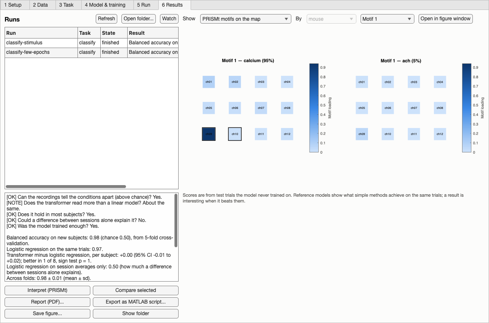
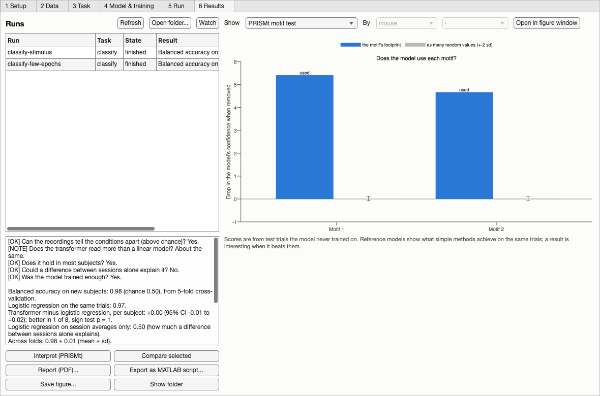

# Interpreting a classifier with PRISMt

A classification score says *whether* the recordings tell the conditions apart. PRISMt says
*where*: which channels, which moments of the trial and which signals drive the model's
predictions, summarized as a few **motifs**. This is the method of the PRISMt paper
(Pattern Reconstruction and Interpretation of Structured Motifs in transformers).

## Running it

- **In the app**: open a finished classification run in the Results tab and press
  **Interpret (PRISMt)**. It runs in the background (a few minutes); the PRISMt views then
  appear in the *Show* menu.
- **In a script**:

  ```matlab
  I = prismt.interpret(runDir);                 % or Classes=["CS-" "CS+"], Rank=3
  figure; prismt.plot.motifMaps(gca, I, Motif=1);
  figure; prismt.plot.modalityAllocation(gca, I);
  figure; prismt.plot.attributionRegions(gca, I, Modality="calcium");
  ```

- **From the command line** (clusters, Python users): `python -m prismt interpret RUN_DIR`.

Results are written to the run's `interpret/` folder (`interpret.json`, `interpret.mat`,
`attribution.npz`); `prismt.loadInterpretation(runDir)` reads them.

## What it computes

1. **Attribution.** For every held-out trial, PRISMt measures how much each token (one
   channel, time bin and signal) pushed the prediction towards one class. It combines two
   things the transformer does: *routing* (how much attention carries the token's
   information to the summary token, followed through all layers: attention rollout) and
   the *message* (what that token's value, through each attention head, adds along the
   direction that changes the decision). Positive values push towards the second class.
2. **Layer and head reduction.** The model's own axes (layers, heads) are removed by
   weighting each head by how differently it attributes the two classes. What is left is
   on the recording's axes: trial × channel × time × signal.
3. **Motifs.** The attribution is factorized into a few components, each the product of a
   **spatial profile** (which channels), a **time course** and a **share per signal**
   (the shares sum to 1, so 0.85/0.15 means 85% of that motif is in the first signal).
   In *trials* mode (the default for recordings) each motif also has an **expression**
   per trial, which can be compared between conditions, animals or learning stages.
4. **Motif test.** A motif shows where the model's attention and messages concentrate; it
   does not by itself prove that the prediction depends on those values. So each motif is
   tested: the values where it is strongest (above 30% of its peak) are removed from every
   held-out trial, and the drop in the model's confidence in the correct class is compared
   with the drop when as many randomly chosen values are removed. A motif counts as *used*
   when its drop is reliably larger (z > 2) and at least 2% of the model's evidence.
5. **Statistics.** Held-out trials are resampled (bootstrap) to give intervals for the
   signal shares and the stability of each motif; labels are permuted (whole sessions or
   animals when the label is constant within them) to test which channels carry
   significant class-dependent attribution: the *PRISMt-selected* channels.

Every trial is explained by the model of the cross-validation fold in which it was held
out, so no trial is explained by a model that was trained on it.

## Reading the views

| View | What it shows |
|---|---|
| PRISMt motifs | One motif as a channel × time map for each signal. A motif carried by one signal is empty in the other. The title says whether the model uses it (see the motif test). |
| PRISMt motifs on the map | The motif's spatial profile on the atlas or channel positions, one panel per signal on a shared color scale; channels with significant attribution are outlined. Without a layout, bars. |
| PRISMt motif test | For each motif, how much the model's confidence drops when the motif's footprint is removed from the trials, next to the drop for as many random values. |
| PRISMt signal shares | Each motif's share per signal, with the bootstrap interval. Above 65% (and an interval above it) the motif is called specific to that signal; otherwise shared. |
| PRISMt motif expression | How strongly each held-out trial expresses a motif, by class, subject or session. |
| PRISMt channels | The class-dependent attribution of every channel; filled bars are significant (p < 0.05, label permutation), * also after correction for the number of channels. |





**How many motifs?** *Rank = auto* chooses the smallest number after which one more motif
reduces the decomposition error by less than 2% (the error for each number is in
`interpret.json`). For comparisons between groups or learning stages, fix the number once
and keep it, so that a change in rank is never mistaken for a change in structure.

## What it does and does not tell you

- **It explains the model, not the brain.** A motif shows what this classifier uses. If the
  classifier does no better than the [reference models](results-and-pitfalls.md#compare-with-the-reference-models),
  there is little worth explaining.
- **Predictive is not the same as used.** A dataset can contain structure that predicts the
  label but that the model never learned to use; methods that look only at the data (class
  differences, PCA) will find it. A motif, in turn, does not prove that the model depends
  on every part of it. That is what the **motif test** is for. Check *which* question you
  are asking: "what differs between conditions" (look at the data) or "what does the model
  read" (PRISMt and its motif test).
- **Confounds pass through.** If the classifier uses a confound (a session-level offset,
  missing data that differ by class), PRISMt will faithfully show it. The
  [pitfalls page](results-and-pitfalls.md#confounds) lists the checks to run first.
- **Time resolution follows the tokens.** With *time bins per token* above 1, every token
  spans several bins, and its attribution is shared equally among them.
- **More than two classes**: PRISMt contrasts two classes at a time (*Classes*).

