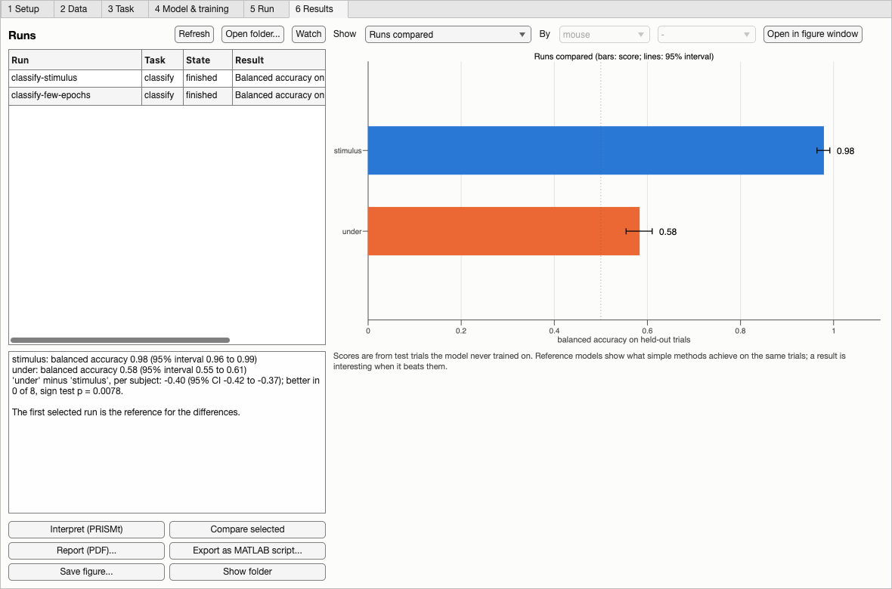

# Reading the results, and the pitfalls PRISMT guards against

A transformer can reach a high score for the wrong reason: it recognizes the subject, the
session, or where data are missing, instead of the condition you care about. This page says
what each number means, what PRISMT does to keep it honest, and what is still up to you.

## Start with the verdict

The first view of every run (*Show: Verdict*) answers the questions on this page in words,
each with a colored mark and the numbers behind it:

| Question | How it is decided |
|---|---|
| Can the recordings tell the conditions apart (above chance)? | *Yes* only when the 95% interval of the score, from resampling subjects, lies above chance (and the shuffled-label test, if it was run, gives p < 0.05). |
| Does the transformer read more than a linear model? | The per-subject difference to logistic regression: *Yes* when its interval lies above 0, *About the same* when it includes 0, *No, the linear model is better* when it lies below. |
| Does it hold in most subjects? | In how many subjects the score is above chance (*Yes* from three quarters). |
| Could a difference between sessions alone explain it? | *Possibly* when logistic regression on session averages scores within 0.05 of the transformer and well above chance. |
| Was the model trained enough? | *No* when the model barely fitted even its training trials; *Probably not* when it was still improving at the epoch limit. |

Green means yes or fine, amber means look at this before concluding, red means a problem,
gray is for information. The answers are deliberately conservative: an interval that
includes "no effect" is never a yes.

**If "trained enough" is not green, fix that first.** A model that was stopped early, or was
too small to fit, gives a low score that says nothing about your recordings. The usual sign
is a transformer far below logistic regression: the linear model shows the information is
there, and the transformer simply has not learned it yet. Raise *Epochs (at most)*, use the
Standard preset, or use *Find the best model*. (The Quick preset trains for up to 80 epochs
and reaches the linear model's score on the 8-mouse demo; a handful of epochs does not.)

**Comparing runs.** To ask what a signal adds (behavior, ACh), train with and without it
(Task tab, *Which channels and signals*), select both runs in the list (Ctrl/Cmd or Shift),
and press **Compare selected**. The plot shows each run's score with its interval, and the
summary gives the difference per subject with its interval. In a script:
`C = prismt.compareRuns([runA, runB])`.

**Report.** **Report (PDF)...** writes the verdict, the key figures, the PRISMt motifs (if
the run was interpreted), the settings and a methods paragraph to paste into a manuscript
and edit (`prismt.report(runDir)`; the paragraph is also saved as `report_methods.txt`).

## What the score is

Every run splits the trials three ways:

| Part | Used for |
|---|---|
| **Training** | Fitting the model. |
| **Validation** | Deciding when to stop and which epoch to keep (and, when tuning, which settings win). |
| **Test** | The reported score. Test trials are evaluated **once**, after training, and never influence any choice. |

The normalization (z-scoring) is also fitted on training trials only.

**Classification** reports **balanced accuracy**, the average of the per-class accuracies,
so a model that always guesses the most common class scores 1/number of classes (0.5 for
two classes) however unbalanced they are. Accuracy, macro-F1, AUROC and the confusion
matrix are in the run's `metrics.json`.

**Masked autoencoder** reports the **R² of the hidden values**: 1 is perfect, 0 is no better
than predicting the average, and below 0 is worse than that. Each hiding pattern (random,
whole channels, forecast, whole signal) is scored separately.

## Compare with the reference models

Each result comes with simple models evaluated on the **same test trials**:

- classification: chance, always guessing the most common class, logistic regression on the
  trial's values, and (with a session column) logistic regression on each trial's
  **session average** only;
- autoencoder: the trial-average (PSTH) of each channel and time, the mean of the visible
  values of the same channel, the last visible value, interpolation between visible values,
  and **ridge**: a linear prediction of each hidden channel from the other channels' visible
  values at the same time, fitted on training trials. Ridge is the reference that matters
  when whole channels or a whole signal are hidden: "channel X is predictable from the
  others" means little if a linear combination of its neighbours does as well.

A transformer score is only interesting when it beats these. For classification the summary
says by how much, **per subject** (or session): the transformer's balanced accuracy minus
logistic regression's in each subject, with a 95% interval from resampling subjects and a
sign test ("better in 6 of 8 subjects"). A difference whose interval includes 0 is not
evidence that the transformer reads more than a linear model. When logistic regression does
as well or better (common with a few thousand trials), that is itself a finding: the
information is there, but no complex model is needed to read it out. The quick preset is
also deliberately small; train longer or use the Standard preset before concluding the
transformer cannot do better.

## Testing on new subjects

Trials of one subject (an animal, a participant) and of one session are not independent:
they share the subject's anatomy, the recording quality, the day's arousal. A model tested
on held-out *trials* of subjects it trained on can score high by recognizing each subject.
Tested on *new subjects*, the score says whether the effect generalizes.

- **Test on: Automatic** (the default) tests on new subjects when there are at least three,
  else on new sessions, else on held-out trials, and the Checks say which it chose.
- If a label is the same for all trials of a session (like `phase`: a whole session is
  early or late), testing on held-out trials or sessions of the same subjects would let the
  model recognize sessions. PRISMT refuses this (error `E_LEAKY_SPLIT`, with the fix). It
  can be overridden (`split.allow_leaky`), but the run is then flagged `leaky_split` and
  its scores are marked as inflated.
- Without a subject column, PRISMT warns that the score only shows the model works on
  held-out trials, not on new subjects.

## Cross-validation (the default)

A single test set of a few subjects gives a score that depends on which subjects happened
to be in it (with 11 mice, a 20% test set is two mice). So PRISMT cross-validates by
default: with 6 or more subjects (or sessions, or trials, depending on *Test on*), 5 folds;
with 3–5, *leave one out*. Every subject is then tested exactly once, by a model that never
saw it. The headline score pools the test predictions of all folds; the summary also gives
the mean ± sd across folds. Cross-validation trains one model per fold, so it takes about
5 times longer than a single split; `split.folds = 1` gives a single split when speed
matters more (on a cluster the folds run in parallel).

Look at **Accuracy per subject**: one dot per subject shows whether the effect holds in most
subjects or comes from one or two. With four subjects, a score of 0.7 can mean "every
subject about 0.7" or "two at 0.9 and two at chance"; these support very different
conclusions.

## Confounds

**Trial info** (Data tab) counts trials for two columns. If, for example, every late
session also has a different lick rate, a model classifying `phase` may learn licking.
PRISMT's check warns when another column almost perfectly predicts the label
(`W_CONFOUND`, Cramér's V ≥ 0.9) and when classes differ in how much data is missing
(`W_MISSING_BY_CLASS`), since a model can tell classes apart by where values are missing.
What to do about a confound depends on the question: balance it, test within one level of
it (a trial filter), or report it.

**Differences between sessions.** When the label is the same for every trial of a session
(learning phase, drug day), anything that differs between recording days can separate the
classes: indicator expression, bleaching, focus, the day's arousal. Two tools help:

- the **session-level reference** (logistic regression on each trial's session average) is
  reported with every classification that has a session column. If it scores close to the
  transformer, a session-level difference may explain the result;
- **Scaling: zscore_session** (`preprocess.normalize`) scales every channel within each
  session, which removes slow offsets and gain changes between sessions. It uses no labels,
  but test sessions are scaled with their own statistics.

Behavior recorded as an extra signal (e.g. running speed) is used by the model like any
other input. To ask whether the neural signal alone carries the information, train once
with and once without it (`selection.modalities`).

## Reading autoencoder results

- **Predictability per channel** (random or whole-channel hiding) shows which channels can
  be predicted from the others. A channel that is pure noise, or badly imaged, is not
  predictable; on the demo data the planted noise channel shows up this way.
- **Gain over baseline per channel** subtracts the best reference model, so a bright
  channel is one where the transformer uses information the trial average does not have.
- A **negative forecast R²** is common for a model trained with random hiding: predicting
  the second half of a trial from the first is a different, harder task. Train with
  *Hide: The future* to ask that question.
- **Predictability by condition** (e.g. early vs late) is computed after the fact from
  per-trial sums, with intervals from resampling sessions. It is exploratory: the model
  was not trained to compare conditions, and several conditions compared this way invite
  false positives.

## Finding the best model

Choosing the best of many settings is part of fitting the model, so it must not see the
trials the model is scored on, including through another fold. *Find the best model*
therefore selects **within each fold**: fold k tries settings (learning rate, dropout, width,
depth, and for classification whether to pretrain the encoder as a masked autoencoder)
using only its own training and validation trials, retrains its best settings, and tests
them once on its test trials. The pooled score is an honest estimate of "search, then
train". The summary lists the settings each fold chose; if they differ a lot between folds,
no single setting is clearly best for these data. The *consensus* settings (majority and
median of the folds' choices) describe the best model; they were not used to compute the
score. (Tuning once on a single fold's validation trials would not be: those trials are
test trials of the other folds.)

Two search methods are available (*Method*, `hpo.method`):

- **One after another (TPE)**: settings are tried one at a time, each choice informed by how
  the earlier ones did (Optuna's TPE), and clearly losing tries are stopped early.
- **Evolve a population (PBT)**: population-based training, an evolutionary method. A
  population of models (`hpo.population`, default 8) trains side by side; every few epochs
  (`hpo.pbt_interval`) the weakest quarter copy the weights and settings of the strongest
  and perturb their learning rate, weight decay and dropout. The best model at the end is
  tested once. Because it adapts settings during training, PBT often reaches a better score
  than any fixed setting; it costs about the population size times one training run per
  fold. `hpo/fold_<k>/pbt_history.csv` records every generation and every copy.

*Repeats per fold* (`train.seeds`) trains each fold several times with different seeds and
keeps the repeat with the best validation score; the summary reports the range of the
repeats' test scores, which shows how much a result depends on the seed.

## Interpreting a classifier

[Interpreting a classifier with PRISMt](interpretation.md) explains which channels, times and
signals a classifier uses. Interpret only models that beat the reference models, and keep in
mind that PRISMt explains the model: a confound the model uses shows up as a motif.

## Chance with few trials

With few test trials, a score well above 1/number of classes can still happen by chance.
`baselines.permutations` (e.g. 200) refits logistic regression with shuffled training
labels, on the same split, to give the scores reached when there is no effect. When the
label is the same for whole sessions or subjects, whole sessions or subjects are shuffled, so
the comparison keeps the data's structure. The run then reports the chance level for your
data (the 95th percentile is drawn in *Score vs reference models*) and a p-value for the
transformer's score against that null (which is built from logistic regression, the model
that is refitted; the transformer itself is not retrained on shuffled labels). It is slow for large datasets, so it is off by default.

## Reproducing a run

A run folder contains everything needed to repeat it: `config.json` (the resolved
settings), `run_info.json` (versions, device, git commit), `splits.csv` (which trial was
in which part), and `launch.sh` / `launch.cmd` (the exact command). *Export as MATLAB
script* writes the settings as a script. Results can differ slightly between devices (CPU,
Apple GPU, NVIDIA GPU) because their arithmetic differs; the splits and hidden-value masks
do not, since they are drawn on the CPU from fixed seeds.

